<h1 align="center">StripSense</h1>

<p align="center"><b>The medicine companion that checks what is in your hand, speaks through your hand,<br>and turns taking medicine into a habit you keep.</b></p>

<p align="center">
  
  
  
  
  
  
  
</p>

<p align="center"><i>iQOO Hackathon 2026 · Grand Finale, Bengaluru · Smart Living track<br>Designed and built in the 41-hour event window by Bishal Roy</i></p>

<p align="center">
  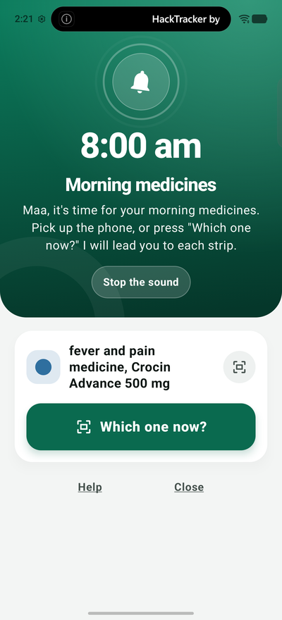
  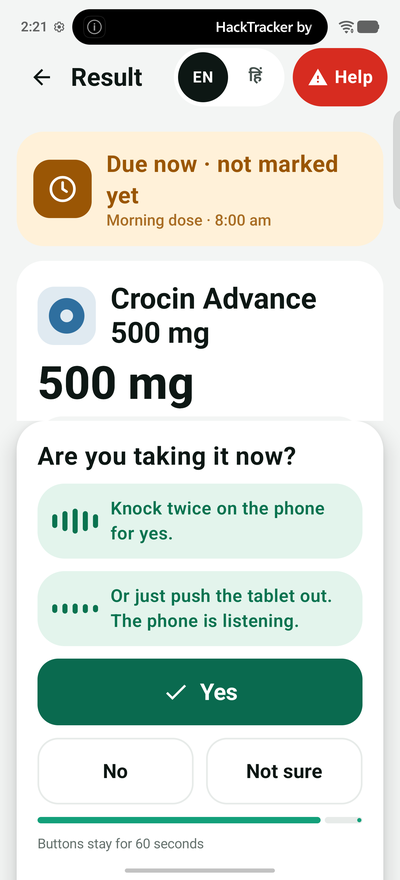
  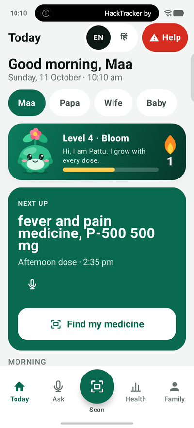
  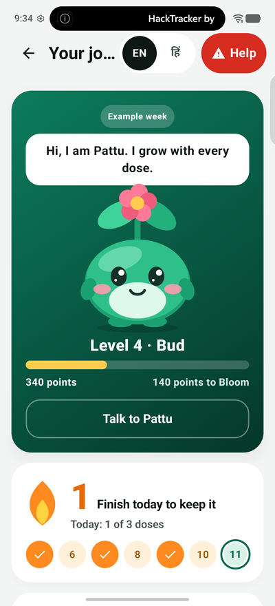
</p>

---

## The problem

An older person has five silver strips on the table. The print is two millimetres high and in English.

| | |
| --- | --- |
| **1 in 3** | adults aged 60+ in six Indian urban areas take five or more medicines a day (Sci Rep, 600 people, 2022 to 24) |
| **32%** | of Indians aged 60+ have poor near vision even with their own glasses (LASI, 2017 to 18) |
| **about 3 in 100** | Indians aged 60+ report trouble with both seeing and hearing (LASI wave 1, self-reported) |

Every medicine app stops at the alarm. The mistake happens after it: the wrong strip, the wrong strength, the same medicine twice. And for someone who cannot see or hear well, none of those apps can be used at all.

## The answer, in one picture

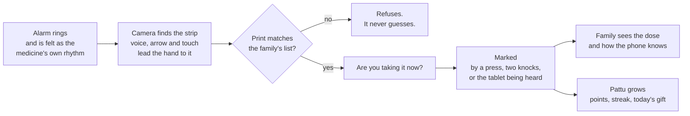

## Four things a reminder app does not do

| | What StripSense does | Where |
| --- | --- | --- |
| **It checks what is in the hand** | Reads the strip's print over several frames and compares the name and the strength with the family's own saved strip. A different strength is always a refusal. | `core/scan` |
| **It speaks through the hand** | The phone's two vibration motors carry a small language: which way to move, yes, no, which medicine, "are you taking it now?", done. A whole dose can be done with eyes closed in a silent room. | `core/guide`, `ui/shell/Feel.kt` |
| **It was there** | The camera saw the strip and the microphone heard the tablet come out of the foil, so a dose needs no button. The family sees how each dose is known: seen and heard, strip seen, or button pressed. | `core/hear`, `core/dose/Proof.kt` |
| **It becomes a habit** | Points that reward what the phone itself witnessed, levels, a row of days, a gift and a chat every day, games, and a character called Pattu who grows with every dose. It also counts the tablets and says before they run out. | `core/play`, `core/dose/Supply.kt` |

## The app

<table>
  <tr>
    <td align="center"><br><b>The alarm</b><br>A full ringing screen. Picking the phone up answers it.</td>
    <td align="center"><br><b>The question</b><br>Answered by a press, two knocks, or the tablet's sound.</td>
    <td align="center"><br><b>Today</b><br>The whole family on one phone.</td>
  </tr>
  <tr>
    <td align="center"><br><b>The journey</b><br>Pattu, the level, the flame and the week.</td>
    <td align="center">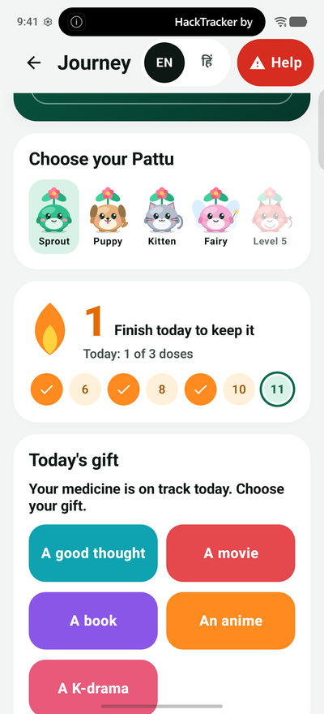<br><b>Five Pattus, and a gift</b><br>One opens at each level. A gift every day.</td>
    <td align="center">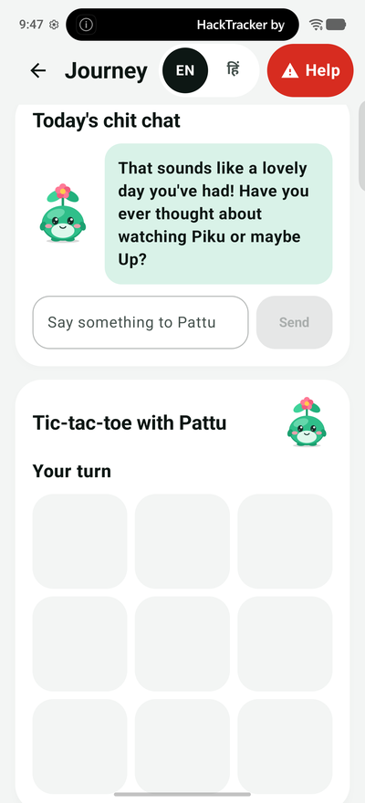<br><b>Today's chit chat</b><br>Answered on the phone by Gemma.</td>
  </tr>
  <tr>
    <td align="center">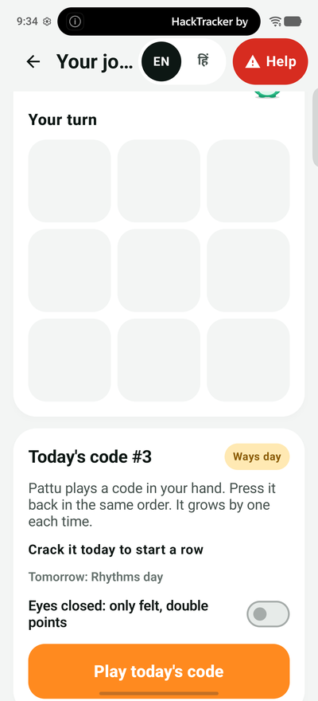<br><b>Games</b><br>Tic-tac-toe with Pattu, and one code a day.</td>
    <td align="center">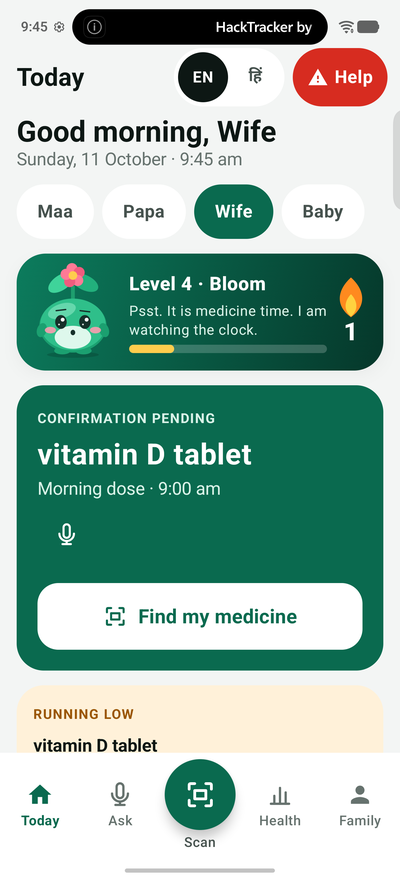<br><b>Running low</b><br>The phone counts the tablets by itself.</td>
    <td align="center">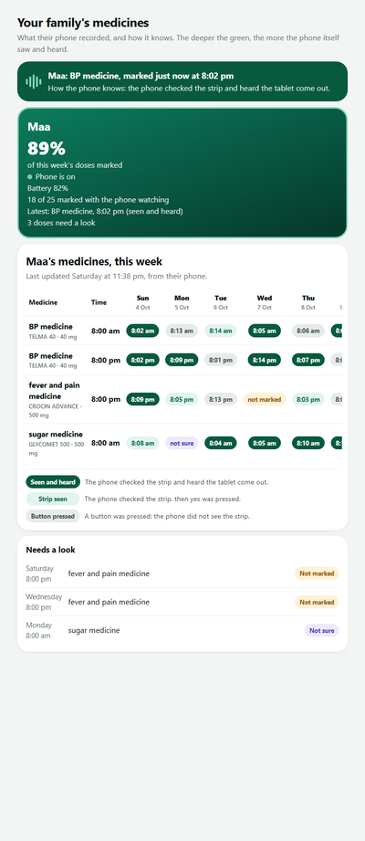<br><b>The family's page</b><br>Sealed on the phone, opened only by the family.</td>
  </tr>
</table>

## Everything it does

**Finding and checking**
- Reads print with ML Kit and gathers it over about 2.5 seconds of frames, because foil is shiny and one frame is never enough.
- Follows several strips in view at once, each with its own box.
- Says which way to move the phone, draws an arrow, and plays that way's own pattern in the hand.
- Point a finger at a strip: "Yes, this is the one" or "Not this one, yours is to the right".
- Warns when two strips have the same ingredient and one was already marked today.
- Reads the expiry date. Says "This is Papa's medicine. It is not yours."
- Ask the camera out loud: "Is this my BP medicine?"

**The dose**
- An exact alarm as a full ringing screen, with every medicine of that time.
- Picking the phone up stops the ringing and opens the camera.
- One press goes through every strip of that time, one after another.
- "Are you taking it now?" is answered by a press, by two knocks on the phone, or by the tablet being heard. The phone says what it marked and Undo stays for a minute.

**Supply and the doctor's course**
- The family counts once ("30 tablets") and says for how many days the doctor prescribed.
- Every marked dose takes one away. "9 tablets left, enough for 4 days." "Day 3 of 5."
- Days ahead: "Only 2 days left. Tell your family to buy more." When a course ends: "Ask the doctor before you go on."

**For the family**
- Several people on one phone, each with their own medicines.
- Teach a strip by showing it. Read a prescription against the strips the family owns.
- A message in the family's own voice for each medicine.
- The week as a Health tab, and a family page anywhere in the world, sealed end to end.

**The journey**
- Points by how the phone knows about each dose: a press 10, a strip the camera checked 20, a tablet the phone heard 30.
- Seven levels, a row of full days, daily goals, badges, and five Pattus to open.
- A gift each day (a thought, a movie, a book, an anime, a K-drama), never the same twice. Another day Pattu asks how it was.
- Tic-tac-toe against Pattu, and one code a day to crack by touch, the same for everyone.

English and Hindi throughout, on the screen and in the voice. Help is on every screen.

## Architecture

One activity, one state holder, and a pure Kotlin core that knows nothing about Android. The phone's senses feed the core; the core decides; fixed sentences speak.

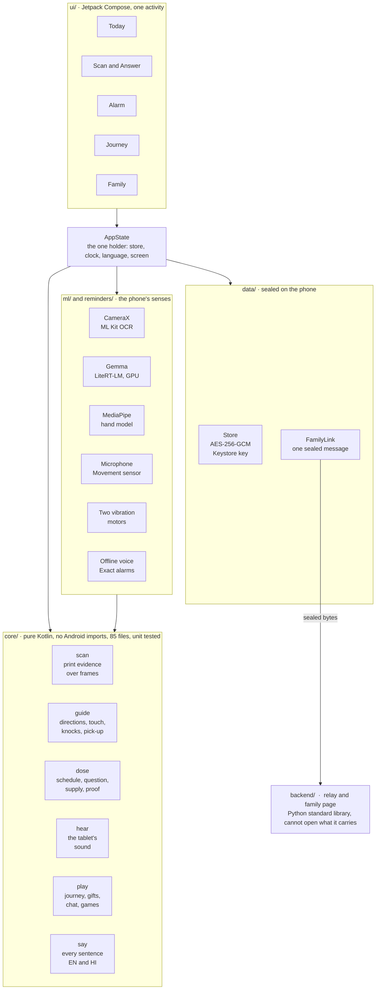

| Layer | What lives there | Rule it keeps |
| --- | --- | --- |
| `core/` | 12 packages of pure Kotlin: `scan`, `text`, `guide`, `dose`, `hear`, `teach`, `say`, `voice`, `report`, `rx`, `play`, `domain` | No `android.*` import. Everything is unit tested. |
| `ml/` | Camera reader, Gemma, the hand finder, the tablet listener, the knock listener, the voice | Models read and listen. They never decide a match and never mark a dose. |
| `data/` | The sealed store, taught photos, voice notes, the family link | Nothing is written in plain. A file that will not open is never overwritten. |
| `reminders/` | Exact alarms and their notifications | No model is started by an alarm. |
| `ui/` | Compose screens: `shell`, `scan`, `today`, `family`, `play`, `setup` | Nothing a developer would need is shown to a family. |
| `backend/` | The relay and the family page | It keeps one sealed message per family and has no key. |

### One dose, end to end

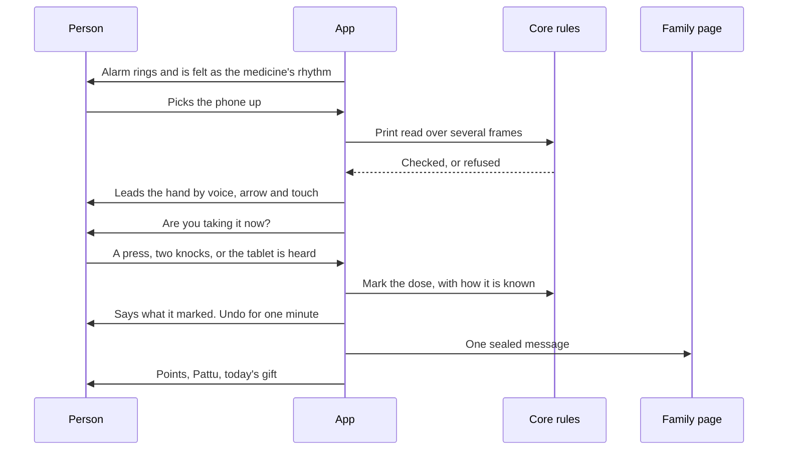

## On-device AI

Everything below runs on the phone. No picture, sound or question leaves it.

| Model | Its job | What keeps it honest |
| --- | --- | --- |
| **ML Kit Text Recognition** | Reads the print on the strip | A name and a strength each need two frames, and nothing may differ |
| **Gemma on LiteRT-LM (GPU)** | Understands a spoken question in Hindi or English, drafts a label when a strip is taught, reads print the fast reader cannot settle, and answers Pattu's small talk | It never writes an answer about a medicine and never decides a match. A question about medicine or health is never sent to the small talk |
| **MediaPipe Hand Landmarker** | Finds a fingertip when a hand is in view | The app's own finger finder covers a finger seen from above |
| **The app's own signal code** | Hears a tablet leave its foil, feels two knocks, notices the phone being picked up | Pure Kotlin, tested on real recordings |

Every answer about a medicine is a fixed sentence from `core/say`. No model can invent a dose.

## The language of touch

The phone has a vibration motor at each end. Each pattern differs in count and length, so a hand tells them apart.

| Felt | Means |
| --- | --- |
| One buzz · two buzzes | Move the phone left · right |
| A tick, then a buzz · a buzz, then a tick | Forward · back |
| Quick ticks, faster and faster | The strip is under the phone, nearing the middle |
| One long buzz that swells | Yes, this is the one |
| Two sharp knocks | No |
| A tap, a rest, a rising hum | "Are you taking it now?" |
| Three taps that grow | Marked |
| A heartbeat · three quick taps · a slow wave | BP · sugar · fever |

With "Touch only" on, the phone makes no sound and the whole dose is done by feel. Two knocks on the phone answer yes.

## Security and privacy

- **On the phone:** one file, sealed with **AES-256-GCM** under a key generated inside the **Android Keystore**. The key never leaves the keystore. Taught photos and voice messages are sealed the same way.
- **To the family:** one message, sealed on the phone with AES-256-GCM under a key made from the family code by **PBKDF2-HMAC-SHA256, 100,000 rounds**. Never a photo, a recording or the camera picture.
- **The relay cannot read it.** It keeps one sealed box per family and has no key. The family's browser opens it; the code sits after the `#` in the link, which a browser never sends to a server.
- **The network is used for the family link and nothing else,** and only once the family turns it on. Scanning, voice, alarms and storage work with no network.

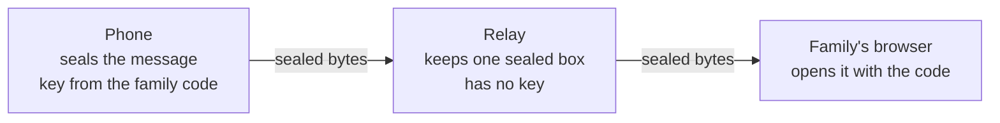

## Rules the code keeps in every case

1. A strip is named only from print that was read. Never from how it looks.
2. A different strength, or anything else that differs, is a refusal.
3. A dose is marked only by an answer to the open question, and the question opens only after the camera has checked the strip.
4. The phone says what it marked, and Undo stays for a minute.
5. It says "marked". It never says a dose was taken, and it gives no medical advice.
6. Help is on every screen.

## Pattu

<p align="center">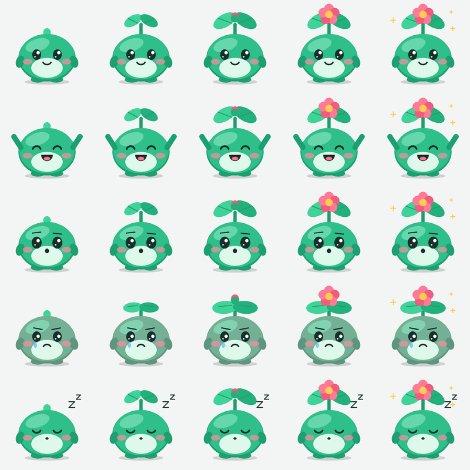</p>

"Patta" means both a leaf and a strip of tablets. Pattu is drawn in code, breathes, blinks and hops, has five moods, and grows from a seed to a flower as the level goes up. There are five to open: Sprout, Puppy, Kitten, Fairy and the Little devil doctor.

## Engineering

| | |
| --- | --- |
| **610** unit tests in **73** classes, all passing | **15** tests of the relay |
| **188** Kotlin files, about **21,000** lines | **85** of them pure Kotlin with no Android in them |
| Real data in the tests | Text the phone really read from three strips, with its misreads. Real recordings of a tablet and of busy rooms. |
| Checks that run on the phone itself | Reading, sealing, the listener, each motor alone, a whole silent dose, a whole heard dose |

**What has been checked**
- Used with real strips through the whole event: reading, refusing, several strips in view, spoken directions, a pointing finger, Hindi.
- No strip named wrongly in the checks on saved photos. Each photo was read again as one still picture and left out of what the engine learned from: it named the right strip or declined.
- A whole dose run on the phone from the alarm to the family page, answered as two knocks do and by the sound of a tablet.
- The phone's own record shows each motor running alone. Storage is unreadable as plain files, and changed bytes are refused.

## Tech stack

| | |
| --- | --- |
| Language and UI | Kotlin 2.4, Jetpack Compose (BOM 2026.09), Material 3, one activity |
| Camera | CameraX 1.6 |
| On-device AI | ML Kit Text Recognition 16, MediaPipe Tasks Vision 1.0, LiteRT-LM 0.17 with Gemma |
| Sensors | Microphone at 48 kHz, accelerometer at 200 readings a second, two vibration motors |
| Storage | One JSON file with kotlinx.serialization, AES-256-GCM, Android Keystore |
| Concurrency | Kotlin coroutines |
| Family link | PBKDF2-HMAC-SHA256, AES-256-GCM, a relay in Python's standard library with SQLite, Web Crypto in the browser |
| Tests | JUnit 4 on the JVM, and an instrumentation harness on the phone |
| Device | iQOO, Android 16. Runs on Android 12 and later |

## Run it

```powershell
# the app: unit tests, then a debug APK, offline
powershell -ExecutionPolicy Bypass -File .\build-local.ps1

# the relay and the family page
cd backend
python -m stripsense_backend relay      # then open http://127.0.0.1:8765

# the relay's tests
python -m unittest discover -s tests
```

The model file `gemma-4-E2B-it.litertlm` is chosen once on the phone. Scanning, alarms and marking work without it.

## Repository map

```
app/src/main/java/app/stripsense/
  core/        pure Kotlin: scan, text, guide, dose, hear, teach, say, voice, report, rx, play, domain
  ml/          camera reader, Gemma, hand finder, tablet listener, knock listener, voice
  data/        the sealed store, photos, voice notes, the family link
  reminders/   alarms and notifications
  ui/          Compose screens: shell, scan, today, family, play, setup, theme
app/src/test/        610 unit tests
app/src/androidTest/ checks that run on the phone
backend/             the relay and the family page
docs/                design notes written before the event, and the screenshots above
DOCUMENTATION.md     the whole app, written down
```

## What comes next

- Put it in the hands of people who cannot see or hear well. It was built in one weekend, and they are the ones to judge the language of touch.
- Count accuracy over many live tries, and how often the phone hears a tablet rightly. Until that is counted, no percentage is claimed.
- A public relay, more languages, and the family's page showing Pattu and the tablets left.

## Credits

Built by **Bishal Roy** at the iQOO Hackathon 2026 Grand Finale. All app code was written during the event; the design notes in `docs/` were written before it, as the rules allow. AI coding agents were used as tools during the build. Test recordings are from freesound.org, with their authors and licences in `app/src/test/resources/sounds`. ML Kit, MediaPipe, LiteRT-LM and Gemma are Google's.

It gives no medical advice. It never says a dose was taken, only that it was marked.
